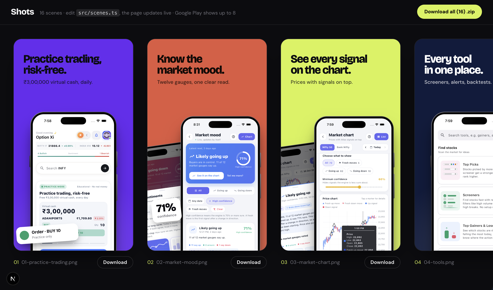

# Shots — Store Screenshot Generator

Generate polished, store-ready app screenshots (**1080 × 1920 PNG**) for Google Play from a single config file. Drop in your real app screenshots, edit some text and colors, and export all scenes as individual PNGs or one `.zip`.

No design tool needed — everything lives in `src/scenes.ts` and the preview updates live as you edit.

## Preview



## Features

- **Single config file** — every scene is one block in `src/scenes.ts`
- **Live preview** — edit the file, the page updates instantly
- **One-click export** — download a single scene or all of them as a `.zip`
- **Store-ready size** — 1080 × 1920 PNGs, first 8 scenes marked as the Google Play picks
- **Device frames** — `iphone`, `pixel`, or `none`, set globally or per phone
- **Multi-phone layouts** — position, size and tilt each phone freely
- **Callouts** — notification toasts, speech bubbles and big-number stats
- **Flexible backgrounds** — any CSS color or gradient
- **Placeholders** — scenes without an image show a built-in placeholder screen

## Tech stack

- [Next.js](https://nextjs.org/) (App Router) + React + TypeScript
- [Tailwind CSS](https://tailwindcss.com/)
- [html-to-image](https://github.com/bubkoo/html-to-image) for PNG rendering
- [JSZip](https://stuk.github.io/jszip/) for bulk export
- Fonts: Bricolage Grotesque and DM Sans (Google Fonts)

## Getting started

```bash
# install dependencies
npm install

# start the dev server
npm run dev
```

Open <http://localhost:3000>.

## Usage

1. Put your app screenshots in `public/shots/` (e.g. `public/shots/home.png`).
2. Open `src/scenes.ts` and edit the scenes: headline, subline, colors, phone positions, callouts.
3. Check the live preview in the browser.
4. Click **Download** on a scene, or **Download all (.zip)** in the header.
5. Upload the PNGs to the Google Play Console.

### Anatomy of a scene

```ts
const practice: Scene = {
  file: "01-practice-trading",          // output PNG name
  background: "#6A2BF2",                // any CSS background
  textColor: "#0B0B10",
  headline: "Practice trading,\nrisk-free.",
  subline: "₹3,00,000 virtual cash, daily.",
  phones: [
    { image: "/shots/home.png", x: cx(780), y: 660, width: 780 },
  ],
  callouts: [
    { kind: "toast", title: "Order · BUY 10", body: "Practice only",
      color: "#22A06B", x: 24, y: 1690, rotate: -4 },
  ],
};
```

Then list it in the `SCENES` array at the bottom of the file. The order there is the export order.

### Options reference

| Field | Description |
|---|---|
| `file` | Output file name (without `.png`) |
| `background` | Any CSS background — solid color or gradient |
| `textColor` | Headline and subline color |
| `headline` | Use `\n` for a line break. Keep to 2 lines, ~16 characters each |
| `subline` | Optional supporting text |
| `textAlign` | `"left"` or `"center"` |
| `textTop` | Distance of the text from the top (default `130`) |
| `phones[]` | `image`, `x`, `y`, `width`, `rotate`, `frame` |
| `callouts[]` | `kind` (`toast` / `bubble` / `stat`), `title`, `body`, `x`, `y`, `rotate`, `color` |

Helpers: `cx(width)` returns the x that horizontally centers an element of that width. Global settings `DEFAULT_FRAME` and `APP_NAME` are at the top of `scenes.ts`.

### Removing things

- No subline → delete `subline`
- No callout → delete it from `callouts` (or use `[]`)
- No phone → delete it from `phones`
- No scene → remove it from the `SCENES` list

## Project structure

```
├── preview/              # screenshot used in this README
├── public/
│   └── shots/            # your raw app screenshots
└── src/
    ├── app/
    │   ├── layout.tsx    # fonts and page metadata
    │   └── page.tsx      # preview grid + PNG/zip export
    ├── components/
    │   └── Scene.tsx     # renders one scene
    └── scenes.ts         # ← the only file you need to edit
```

## Google Play notes

- Google Play displays up to **8** phone screenshots, so the first 8 scenes in `SCENES` are the ones to upload. The rest are extras.
- Output size is 1080 × 1920 (9:16), which is accepted for phone screenshots.